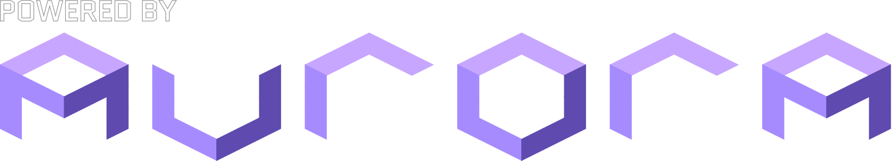

  

  

    <a href="https://discord.gg/T4faGveujK">Discord</a>
  

# Party Board for Nintendo Switch

An unofficial homebrew port of [Party Board](https://github.com/mariopartyrd/partyboard), the native port of Mario Party 4, to the Nintendo Switch. It is not affiliated with Nintendo or with the Party Board team. Please report Switch problems here, not to them.

**This is an early preview.** It contains no game assets: you need your own copy of the game.

## Status

Tested on one console, in handheld and docked, using the NVK Vulkan driver:

- Runs at about 60 fps in boards and minigames, with sound and movies.
- A full party plays through to the final results, and saving and resuming a party work.
- 18 of the 61 minigames have been played through on the console, with no crashes.
- Switch button prompts in the game's messages, the system's controller screen (- menu > Input >
  Connect Controllers), a volume setting and higher-resolution shadows.

Known problems:

- One crash while loading the disc has been seen once, on launch. If the game closes with an error, launch it again and please report it with the files listed below.
- The first launch, and the first time each new screen appears, can pause while shaders compile.
- The "Quick Transform" setting of the Party Board preset has no effect yet.
- Multiplayer has been tested with two controllers. Rumble has not been tested.
- No 16:9 widescreen yet. The game is shown in 4:3 with bars on the sides; turning off "Lock 4:3 Aspect Ratio" fills the screen by stretching the picture. Real 16:9 is planned for a later version.

## Install

You need a Switch running custom firmware (Atmosphère) and a dump of Mario Party 4 (`GMPE01` USA or `GMPP01` Europe) as `.iso`, `.gcm`, `.ciso` or `.gcz`.

1. Extract `partyboard-switch.zip` to the root of your SD card.
2. Copy your disc image to `sd:/switch/partyboard/`.
3. Hold **R** while opening any installed game to enter the Homebrew Menu in title mode, then start Party Board. It does not run from the Album, which has too little memory.

If you already have a large memory card file, the first launch moves your saves to a smaller card, which makes saving much faster. The original stays in `user/` as `MemoryCardA.USA.raw.bak`.

The game starts directly. To see the launcher menu at startup, turn off **- menu > Interface > Skip Party Board Main Menu**. Its **Startup** tab has the graphics backend, the save file type, the language and, when there is more than one disc image, which one to use. In the game, the **-** button opens the other settings.

With a European disc the game uses the console's language (English, French, German, Spanish or Italian; others use English) unless you pick one under Startup > Language. The USA disc has English only. Both run at 60 fps with the same timing.

### HOME menu icon (optional)

`PartyBoard-forwarder.nsp` adds a Party Board icon to the HOME menu that always starts the game with full memory, so there is no need to hold R. It needs up-to-date sigpatches. Install it with DBI or Goldleaf. It only starts `sd:/switch/partyboard/partyboard.nro`: keep the game there, and update it by replacing that file. Build your own with `tools/switch/build_forwarder.sh` and your console's keys.

When reporting a bug, include `sd:/switch/partyboard/partyboard-log.txt` and the newest file in `sd:/atmosphere/crash_reports/`.

## Building

See [docs/switch.md](docs/switch.md). [docs/port-notes.md](docs/port-notes.md) describes the problems found along the way. `tools/switch/fetch-switch-deps.sh` applies this port's patches to its dependencies from `platforms/switch/patches/`.

## Credits

- [Party Board](https://github.com/mariopartyrd/partyboard) and the [Mario Party 4 decompilation](https://github.com/mariopartyrd/marioparty4), whose work this is built on.
- [Aurora](https://github.com/encounter/aurora), [MusyX](https://github.com/AxioDL/musyx) and [libco](https://github.com/higan-emu/libco).
- [Super Mario Strikers](https://github.com/new-coke/strikers) for the Switch recipe, with [dawn-switch](https://github.com/new-coke/dawn-switch) and [sdl3on2](https://github.com/new-coke/sdl3on2).
- [mesa-switch](https://github.com/danfromtico/mesa-switch) for NVK on Horizon.

Licenses of the bundled software are listed in [platforms/switch/THIRD_PARTY.md](platforms/switch/THIRD_PARTY.md).

Mario Party is a trademark of Nintendo.

---

# Upstream Party Board README

[Build Status]: https://github.com/mariopartyrd/partyboard/actions/workflows/build.yml/badge.svg
[actions]: https://github.com/mariopartyrd/partyboard/actions/workflows/build.yml
[Discord Badge]: https://img.shields.io/discord/994839212618690590?color=%237289DA&logo=discord&logoColor=%23FFFFFF
[discord]: https://discord.gg/T4faGveujK

A work-in-progress Windows/Linux/macOS/Android/iOS port of Mario Party 4.

This repository does **not** contain any game assets or assembly whatsoever. An existing copy of the game is required.

Version Completion:

- `GMPE01_00`: Rev 0 (USA)
- `GMPE01_01`: Rev 1 (USA)

### 1. Download [Party Board](https://github.com/mariopartyrd/partyboard/releases)

### 2. Setup the game

- Extract the .zip file
- Launch partyboard or partyboard.exe depending on your platform.

# Building

If you'd like to build Party Board from source, please read the [build instructions](building.md).

## Common problems

### RenderDoc not working

RenderDoc has some conflict with asan. To turn off asan, you should delete the two lines in `CMakeLists.txt` that enable ASAN for the DOL and the RELs: `set_source_files_properties(..., -fsanitize=address)`

# Credits

Special thanks to the GC/Wii decompilation community, the [Aurora](https://github.com/encounter/aurora) developers, the Dusk developers, all [contributors](https://github.com/mariopartyrd/partyboard/graphs/contributors), [ImWhoreHay](https://x.com/ImWhoreHay) for the font, and justcamtro for designing the assets.

 

    

